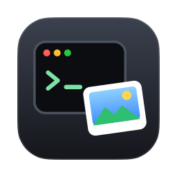
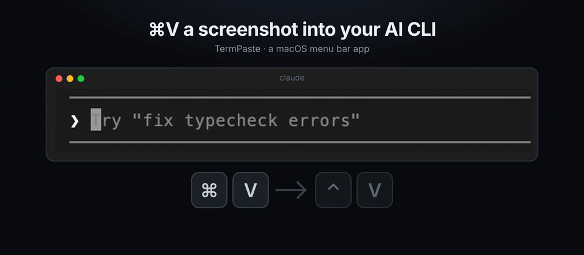
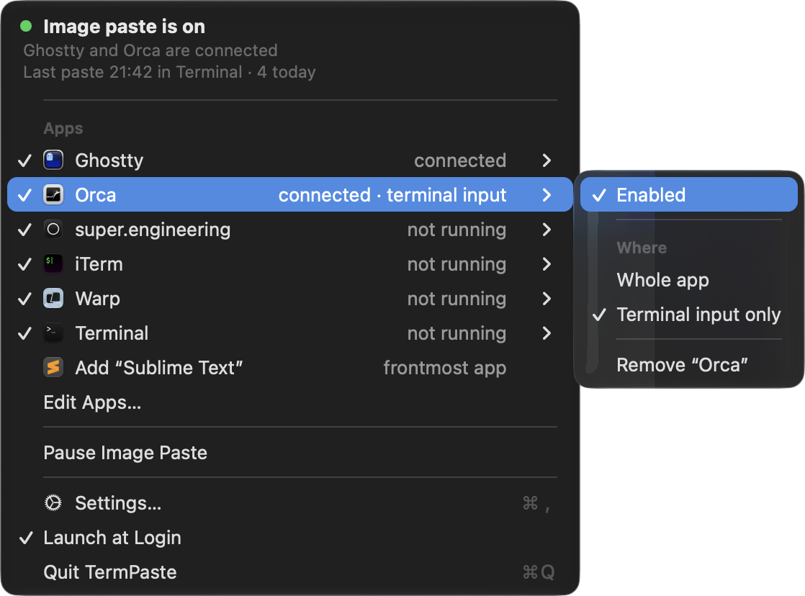
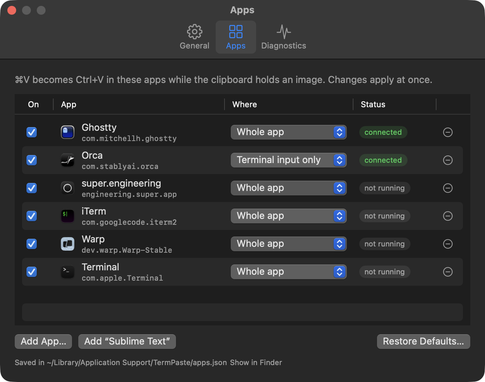

<p align="center">
  
</p>

<h1 align="center">TermPaste</h1>

<p align="center">
  <b>Paste screenshots into Claude Code, Codex and other AI CLIs with ⌘V — in any terminal.</b><br>
  A small macOS menu bar app. No clipboard tricks, no temporary files, no network.
</p>

<p align="center">
  <br>
  <a href="#tour">▶ Watch the 25-second tour</a>
</p>

## The problem

AI coding CLIs attach a clipboard image when they receive **Ctrl+V**. Claude Code documents
Ctrl+V (⌘V only in iTerm2) as its *paste image* key, which inserts an `[Image #N]` chip
([docs](https://code.claude.com/docs/en/interactive-mode)); Codex CLI uses Ctrl+V as well
([openai/codex#2730](https://github.com/openai/codex/issues/2730)).

On a Mac your hands press **⌘V**. In Ghostty and most other terminals ⌘V belongs to the terminal,
which pastes text and file paths but not raw image data, so a screenshot on the clipboard is
silently ignored ([ghostty#10478](https://github.com/ghostty-org/ghostty/discussions/10478)).
Clipboard managers such as [Paste](https://pasteapp.io/help/paste-directly-to-other-applications)
paste with ⌘V too.

## What it does

While the clipboard holds an image **and** one of your chosen apps is in front, ⌘V becomes Ctrl+V.
That is the whole trick.

- **Text pastes are untouched.** So are ⌘⇧V, Ctrl+V, multiple-item clipboards and every app
  you have not listed.
- **Works with any app you add.** Ghostty, Orca, super.engineering, iTerm, Warp and Terminal are
  listed by default. Add Cursor, VS Code, Zed or anything else from the menu bar or Settings; no
  rebuild.
- **Terminal input only, when you need it.** For apps that host a terminal next to chat or search
  fields (Orca), routing can be limited to the focused control named “Terminal input”.
- **Paste apps work too.** Paste's *paste image + Enter* sends ⌘V, so it is covered.
- **Says why it is paused.** Secure Input hides keystrokes from every helper; the menu shows the
  app macOS names and what usually ends it.
- **Private by design.** It looks only at the clipboard's advertised types, never at image bytes,
  text or terminal output, and it makes no network connections.

## Tour

A real paste, the menu bar and the Settings window, in 25 seconds:

https://github.com/user-attachments/assets/e6804d06-aece-4cc9-aa8f-213079444643

## Menu bar and Settings

<p align="center">
  
</p>

Each listed app shows whether it is connected. Its submenu turns it on or off, chooses
**Whole app** or **Terminal input only**, or removes it. **Add “…”** adds the app you used last.

<p align="center">
  
</p>

Settings has three tabs: **General** (image paste on or off, Launch at Login), **Apps** (the list,
**Add App…** to pick any application, **Restore Defaults…**) and **Diagnostics** (Accessibility,
Secure Input, the last ⌘V decision, signature, and **Copy Diagnostics**).

## Install

### Download

Get `TermPaste-<version>.zip` from the
[latest release](https://github.com/suatkocar/termpaste/releases/latest), unzip it,
move **TermPaste** to `/Applications` and open it. The app is a universal build
(Apple silicon and Intel) for macOS 14 or later, signed with Developer ID and notarized by Apple.

### Build from source

Requires macOS 14 or later and Swift 6 (Xcode 16 or its Command Line Tools).

```sh
git clone https://github.com/suatkocar/termpaste.git
cd termpaste
swift test
bash scripts/build-app.sh       # builds and signs dist/TermPaste.app
bash scripts/install-app.sh     # copies it to /Applications, keeping any earlier copy
open "/Applications/TermPaste.app"
```

When asked, allow **TermPaste** in System Settings → Privacy & Security →
Accessibility. That permission is what lets it see ⌘V; without it, the menu says
**Needs Accessibility** and links to the panel.

**Signing.** `build-app.sh` signs with the first *Developer ID Application* identity in your
keychain. Without one, build ad hoc: `SIGN_IDENTITY=- bash scripts/build-app.sh`. macOS records
the Accessibility permission against the signature, so an ad-hoc build has to be allowed again
after every rebuild, while a Developer ID build keeps it.

## Your app list

The list lives in `~/Library/Application Support/TermPaste/apps.json`. The menu and
Settings write it; you can also edit it by hand, and the app picks up the change within two
seconds.

```json
{
  "apps" : [
    { "bundleID" : "com.mitchellh.ghostty", "enabled" : true, "name" : "Ghostty", "paste" : "image", "scope" : "app" },
    { "bundleID" : "com.stablyai.orca", "enabled" : true, "inputLabel" : "Terminal input", "name" : "Orca", "paste" : "image", "scope" : "terminalInput" },
    { "bundleID" : "dev.zed.Zed" }
  ],
  "version" : 1
}
```

Only `bundleID` is required. `scope` is `app` (default) or `terminalInput`, which needs the
focused text control to carry `inputLabel`. `paste` is reserved for a future *file path* mode;
only `image` is routed today. If the file cannot be read, the last list that could keeps
working and the menu says why; the file is left as it is until you save from the app, which
first keeps a copy named `apps-unreadable.json`.

## How it works

For each running app on the list, the helper attaches a keyboard event tap to that one process.
When a plain ⌘V arrives and that app is frontmost, it checks the clipboard's advertised types:
exactly one item that offers image data. If so, it changes the event's modifier from Command to
Control in place and lets it continue, together with the matching key-up. It never posts a second
keystroke and never writes the clipboard. The CLI then reads the image itself, exactly as if you
had pressed Ctrl+V. [docs/how-it-works.md](docs/how-it-works.md) covers the details and the
trade-offs against other approaches.

## Troubleshooting

| What you see | What to do |
| --- | --- |
| ⌘V with an image does nothing | Open Settings → Diagnostics: Accessibility must be **Allowed**, the app must be **connected**, Secure Input **Off**. |
| “Paused — Secure Input is on” | A focused password field, a password manager or a terminal's *Secure Keyboard Entry* hides keystrokes from every helper. Paste works again when it ends. |
| Asked for Accessibility again after an update | The build was signed ad hoc or with another identity; see *Signing* above. |
| A shell prints `^V` | Ctrl+V reached a plain shell, not an AI CLI. Paste text, or pause image paste from the menu. |
| “Terminal input only” never converts | The app does not name its terminal field; choose **Whole app** for it. |

The command line offers the same information:

```sh
"/Applications/TermPaste.app/Contents/MacOS/TermPaste" --status
"/Applications/TermPaste.app/Contents/MacOS/TermPaste" --clipboard-types
```

`--status` prints the current state: permission, Secure Input, connected apps, counters and the
last decision. It holds no image data, text, file paths or clipboard history.

## Other approaches

- [CopyCat](https://github.com/andyhtran/CopyCat) saves the clipboard image as a JPEG and types its
  file path into the terminal; it can also copy images to SSH hosts. Use it if you work over SSH
  or want a file path rather than an attachment.
- [clipaste](https://github.com/hqhq1025/clipaste) is a background service that adds a file path to
  image-only clipboards, so the terminal's own ⌘V pastes a path; it also bridges SSH.

TermPaste keeps the CLI's own attachment (`[Image #1]`, with its preview and image
handling) and changes nothing but the key.

## Uninstall

Turn off **Launch at Login** in the menu, quit the app, and move
`/Applications/TermPaste.app` to the Trash. Its settings are in
`~/Library/Application Support/TermPaste` and the preference domain
`com.suatkocar.termpaste`; remove it from the Accessibility list as well.

## Development

| Path | Contents |
| --- | --- |
| `Sources/PasteRouting` | Pure, tested logic: key routing, event mapping, clipboard probe, app list, focus policy, Secure Input report, login agent |
| `Sources/TermPaste` | The AppKit app: event taps, menu, Settings window (SwiftUI), status icon |
| `Tests/PasteRoutingTests` | Unit tests; they use private pasteboards and never post input |
| `Resources` | `Info.plist`, `AppIcon.svg` and the generated `AppIcon.icns` (`scripts/make-icon.sh`) |
| `scripts` | Build, sign and install (`build-app.sh`, `install-app.sh`), a notarized universal release (`release.sh`), the icon (`make-icon.sh`) |

## License

[MIT](LICENSE)
